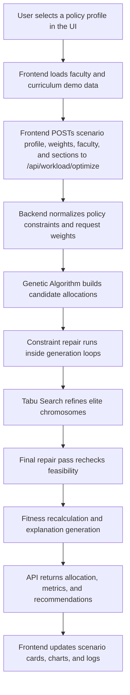
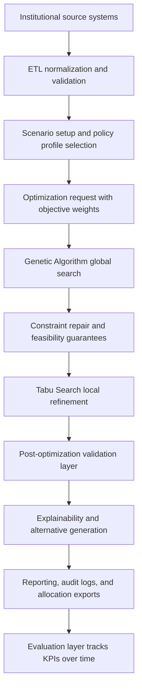

# System Flow Status

This document separates the current implemented flow from the target architecture flow.

## As-Built Flow (Current)

1. User selects a policy profile or custom scenario in the UI.
2. Frontend requests demo faculty data from /api/faculty/.
3. Frontend requests demo curriculum/section data from /api/curriculum/.
4. Frontend POSTs faculty, sections, policy profile, and objective weights to /api/workload/optimize.
5. Backend validates payload, rejects empty sections or faculty, and normalizes policy constraints.
6. Genetic Algorithm initializes population, evaluates fitness, applies selection/crossover/mutation, and in-loop constraint repair.
7. Top GA elite chromosomes are passed to Tabu Search for local refinement.
8. Tabu Search applies tabu/aspiration logic, then a final repair pass is applied to the best solution.
9. Fitness is recalculated and explainable recommendations are generated.
10. API records the run in shared history for reporting and KPI tracking.
11. API returns allocation, metrics, policy metadata, and explanations.
12. Frontend updates cards, convergence chart, scenario status, and optimization logs.
13. Reports and analytics pages read the shared runtime history and exportable summaries.

## Target Flow (Architecture)

1. Data gathering from institutional systems (faculty HRIS, course offerings, room/schedule system, policy store).
2. Data integration and validation (ETL normalization + quality checks + conflict checks).
3. Scenario setup and policy profile selection from the UI.
4. Optimization run request with explicit objective weights and constraint profile.
5. Genetic Algorithm global search with adaptive mutation and elitism.
6. Constraint repair and feasibility guarantees after each generation.
7. Tabu Search local refinement with neighborhood strategies and aspiration rules.
8. Post-optimization validation layer checks policy, load balancing, and fairness rules.
9. Explainability layer produces assignment rationale and alternatives.
10. Reporting layer exports dashboards, audit logs, and allocation reports.
11. Evaluation layer measures effectiveness and software quality KPIs over time.

## Gap Summary

- Current system uses seeded API input data, not connected institutional sources.
- Evaluation/reporting exists at a basic metrics level but not yet full KPI analytics pipeline.
- Advanced institutional validation and external system integration remain future work.
